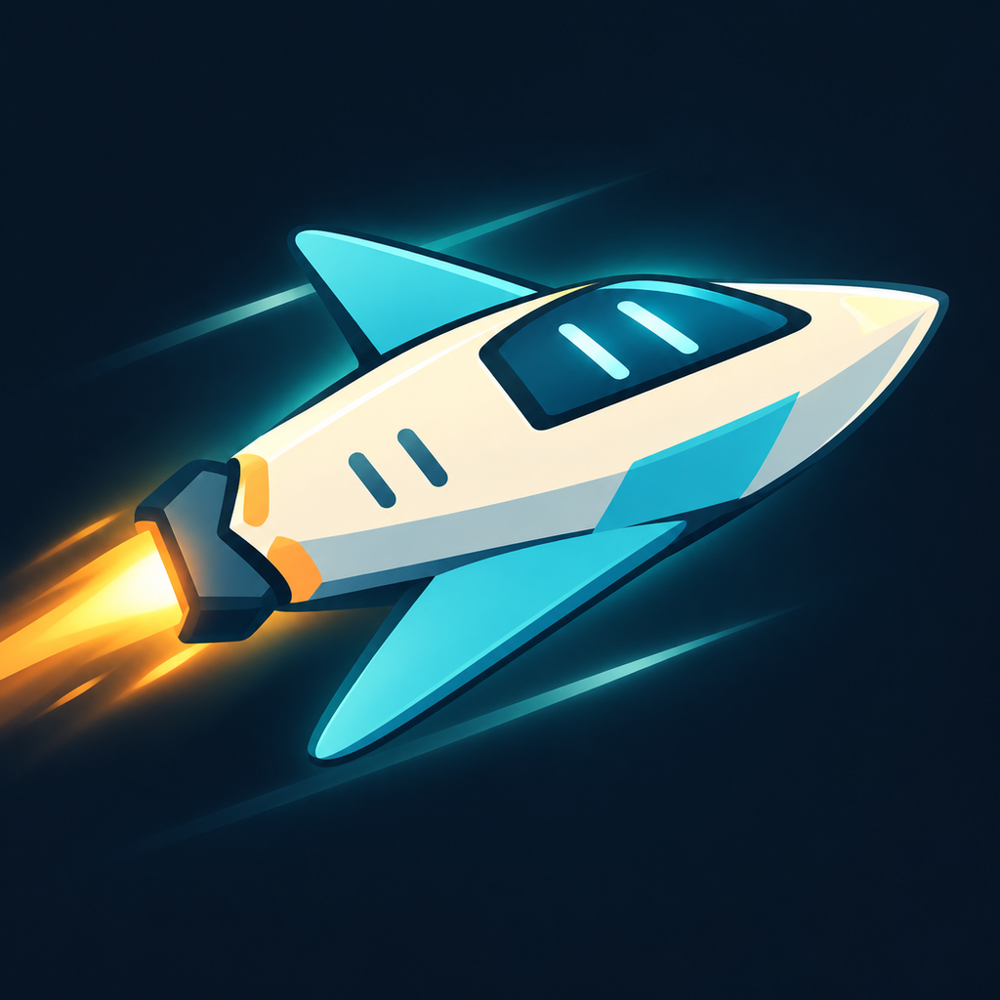

# 🚀 Neo Glide

[](https://opensource.org/licenses/MIT)
[](https://www.apple.com/ios/)
[](https://reactjs.org/)
[](https://capacitorjs.com/)

**Neo Glide** is a fast-paced neon arcade space shooter with stunning cyberpunk visuals and addictive roguelike progression. Pilot customizable ships through an endless neon void, battle fierce enemies, and see how far you can survive!

<p align="center">
  
</p>

## ✨ Features

- 🎮 **Intense Arcade Action** - Fast-paced gameplay with smooth 60fps performance
- 🛸 **5 Unique Ships** - Each with special abilities (Cruiser, Interceptor, Stealth, Void Runner)
- ⚡ **4 Weapon Types** - Plasma Cannon, Burst Laser, Missile Launcher, Railgun
- 👾 **3 Enemy Types** - Speedster, Standard Fighter, and Juggernaut with unique behaviors
- 💎 **Roguelike Progression** - Permanent upgrades that carry between runs
- 🎨 **Stunning Neon Visuals** - Cyberpunk-inspired graphics with particle effects
- 🎵 **Dynamic Soundtrack** - Retro-style music that adapts to gameplay
- 📱 **Mobile-Optimized** - Portrait mode, one-handed controls, responsive UI
- 🏆 **Leaderboard System** - Compete globally and track your best scores

## 🎮 Gameplay

- **Tap and hold** to boost your ship through space
- **Dodge** obstacles and enemy projectiles
- **Tap the fire button** to unleash your weapons
- **Collect** fuel and currency to extend your run
- **Upgrade** your ship between runs to become unstoppable

## 🛠️ Tech Stack

### Frontend
- **React 19.0.0** - UI framework
- **Vite 7.2.2** - Build tool and dev server
- **Tailwind CSS 4.1.17** - Utility-first CSS framework
- **Lucide React** - Icon library

### Mobile
- **Capacitor 7.4.4** - Native iOS integration
- **CocoaPods** - iOS dependency management

### Game Engine
- **HTML5 Canvas** - Custom rendering engine
- **Web Audio API** - Procedural sound generation
- **RequestAnimationFrame** - Smooth game loop

## 📦 Installation

### Prerequisites
- Node.js 18+ and npm
- Xcode 27+ with the iOS simulator runtime (for iOS development)
- CocoaPods

### Setup

1. **Clone the repository**
   ```bash
   git clone https://github.com/cgtygrss/neon-glide.git
   cd neon-glide
   ```

2. **Install dependencies**
   ```bash
   npm install
   ```

3. **Run in development mode**
   ```bash
   npm run dev
   ```
   Open [http://localhost:5173](http://localhost:5173) in your browser.

## 📱 iOS Build

### Build for iOS

1. **Build the web assets**
   ```bash
   npm run build
   ```

2. **Sync with iOS**
   ```bash
   npx cap sync ios
   ```

3. **Open in Xcode**
   ```bash
   npx cap open ios
   ```

4. **Run on simulator or device** from Xcode

### iOS Requirements
- iOS 15.0 or later
- Portrait orientation
- Safe area inset support

## 🎯 Project Structure

```
neon-glide/
├── src/
│   ├── components/
│   │   ├── HUD.jsx              # Game UI overlay
│   │   ├── Shop.jsx             # Upgrade shop
│   │   └── Leaderboard.jsx      # Score tracking
│   ├── game/
│   │   ├── Entities.js          # Game objects (Player, Enemies, etc.)
│   │   ├── GameLoop.js          # Main game loop
│   │   ├── Renderer.js          # Canvas rendering
│   │   └── SoundManager.js      # Audio system
│   ├── App.jsx                  # Main app component
│   ├── App.css                  # Global styles
│   └── main.jsx                 # Entry point
├── ios/                         # iOS native project
├── public/                      # Static assets
├── resources/                   # App icons and splash screens
├── capacitor.config.json        # Capacitor configuration
├── package.json                 # Dependencies
└── vite.config.js              # Vite configuration
```

## 🎨 Game Systems

### Credit Economy
- Coins are worth 50, 100, 250, 500 or 10,000 credits. Five-coin trails pay 550 normally, 1,200 every fourth trail, and 11,500 every twelfth trail before upgrades and combos. Every twelfth trail includes one 10,000-credit coin.
- Combo payouts cap at 2×. Data Multiplier adds 0.25× per level and caps at 2× at level 5; further purchases are disabled without deleting saved levels.
- Ship prices are 60,000 / 180,000 / 400,000 / 900,000 / 1,800,000 credits. Starter upgrades begin at 5,000 and scale by 1.5× per level.
- Completed flight distance awards 10 credits per meter at the end of a run. Boss defeats and pilot level-ups each award 10,000 credits. Career rewards are 50,000 / 35,000 / 100,000 / 75,000 credits.
- Optional rewarded ads add one snapshot of flight credits once per run. Bonuses do not grant XP, mission progress, or further ad bonuses, including after revival.
- Wallet/profile v2 records convert legacy balances and lifetime credits by 100× without rewriting the old records. Ownership, upgrades, XP, and levels remain intact. The migration factor remains 100; XP from newly earned credits uses an additional 10× normalization.

### Ship Types
| Ship | Special Ability |
|------|----------------|
| Default | Balanced stats |
| Cruiser | +40 maximum HP |
| Interceptor | 1.5x faster ammo regen |
| Stealth | 50% reduced enemy spawns |
| Void Runner | Phase through small obstacles |

### Weapon Types
| Weapon | Description |
|--------|-------------|
| Plasma Cannon | High damage shots |
| Burst Laser | 3-shot spread |
| Missile Launcher | Explosive projectiles |
| Railgun | Armor-piercing rounds |

### Enemy Types
- **Speedster (Purple)** - Fast, agile, dashes unpredictably (40 HP)
- **Standard Fighter (Red)** - Steady fire rate (40 HP)
- **Juggernaut (Orange)** - Heavy armor, homing missiles (100 HP)

### Upgrade System
- Start with 100 HP. Enemy shots deal 20 HP with 0.9 seconds of protection after a hit.
- Green medical packs restore 25 HP, capped at maximum health; one can appear every 12 seconds of active flight.
- Ships stay inside the top and side screen edges. Reaching the ceiling stops upward movement without damage; falling to the bottom ends the flight. Solid obstacles still end the flight, with ship obstacle abilities preserved.
- Hull Armor (+20 maximum HP per purchased level)
- Shield Generator (1 HP/s regen per level)
- Thruster Boost (+1 movement per level)
- Battery Pack (+20 energy per level)
- Currency Multiplier (earn more per run)

## 🚀 Available Scripts

```bash
npm run dev          # Start development server
npm run build        # Build for production
npm run preview      # Preview production build
npm run host         # Dev server with network access

# iOS specific
npm run ios:build    # Build and open in Xcode
npm run cap:sync     # Sync web assets to native
npm run cap:open     # Open iOS project in Xcode
```

## 🎮 Controls

### Desktop (Development)
- **Mouse Click + Hold** - Boost ship
- **Spacebar** - Fire weapon

### Mobile (iOS)
- **Tap + Hold** - Boost ship
- **Tap Fire Button** - Shoot

## 🌟 Future Enhancements

- [ ] More ship types and weapons
- [ ] Boss battles
- [ ] Power-ups and special abilities
- [ ] Game Center integration
- [ ] iCloud save sync
- [ ] Additional game modes
- [ ] Sound effects customization
- [ ] Achievement system

## Cosmetics store setup

The Garage includes ten permanent visual cosmetics. They apply a shared hull
palette, an engine-history trail, and friendly projectile tint to every ship
and weapon; they never affect stats or hitboxes. Each can also be unlocked for
1,200,000 to 6,000,000 earned credits, depending on the theme. Store ownership and credit ownership are recorded
separately, so a store refund only removes the store right and never removes a
theme earned with credits.

Configure these non-consumable products in App Store Connect and Google Play using the listed USD base prices and localized storefront prices:

| Rank | Theme | Tier | Credits | USD base | SKU |
| --- | --- | --- | ---: | ---: | --- |
| 01 | Copper Horizon | Classic | 1,200,000 | $2.99 | `cosmetic_copper_horizon` |
| 02 | Arctic Pulse | Classic | 1,500,000 | $3.49 | `cosmetic_arctic_pulse` |
| 03 | Cyber Current | Signature | 1,800,000 | $3.99 | `cosmetic_cyber_current` |
| 04 | Jade Drift | Signature | 2,200,000 | $4.49 | `cosmetic_jade_drift` |
| 05 | Rose Circuit | Elite | 2,600,000 | $4.99 | `cosmetic_rose_circuit` |
| 06 | Solar Forge | Elite | 3,000,000 | $5.99 | `cosmetic_solar_forge` |
| 07 | Pearl Comet | Prestige | 3,600,000 | $6.99 | `cosmetic_pearl_comet` |
| 08 | Void Pilot | Prestige | 4,200,000 | $7.99 | `cosmetic_void_pilot` |
| 09 | Cobalt Storm | Legendary | 5,000,000 | $8.99 | `cosmetic_cobalt_storm` |
| 10 | Prism Voyager | Legendary | 6,000,000 | $9.99 | `cosmetic_prism_voyager` |

`ios/StoreKitTests/NeoGlide.storekit` has matching sandbox products. Android
release builds require a configured Play public key for signature verification;
without it, the bridge reports store products unavailable and grants nothing.
Real-store sandbox purchases require the platform's external test accounts.
See [COSMETICS_SETUP.md](COSMETICS_SETUP.md) for console setup and pending
approval behavior.

## 📄 License

This project is licensed under the MIT License.

## 👨‍💻 Author

**Cagatay Gurses**
- GitHub: [@cgtygrss](https://github.com/cgtygrss)

## 🙏 Acknowledgments

- Built with React and Capacitor
- Inspired by classic arcade shooters
- Neon aesthetic inspired by cyberpunk culture

## 📞 Support

For issues, questions, or suggestions:
- Open an issue on [GitHub Issues](https://github.com/cgtygrss/neon-glide/issues)

---

<p align="center">
  Made with ❤️ and ⚡ by Cagatay Gurses
</p>

<p align="center">
  <a href="https://www.apple.com/app-store/">
    
  </a>
</p>

## Galaxy destinations

The Garage has eleven fictional galaxy destinations, including free Milky Way and ten permanent credit unlocks priced from 12,000 to 200,000 credits. Preview any destination, then unlock or equip one for the next flight; ownership and selection are stored on this device. Galaxies change scenery only, not flight mechanics, enemies, rewards, or music. No real-money purchase is required.

## Temporary vehicles

Free MORPH capsules become eligible after 15 seconds of active normal flight, including enemy encounters. Each collected capsule starts a 12-second vehicle ability in the current flight; every five capsules cover all five vehicles without consecutive repeats. After a vehicle ends, the next capsule becomes eligible after 30 seconds of normal flight (12 seconds after a missed capsule).

| Vehicle | Space / Up / left pedal | Shift / right pedal |
| --- | --- | --- |
| Star Striker | Hold to rise, release to glide | Three parallel straight missiles, 2.4-second cooldown |
| Comet Drill | Hold to rise, release to glide | Protected drilling dash, 2.5-second cooldown |
| Storm Sphere | Flip gravity | Nearby barrier pulse, 2-second cooldown |
| Volt Ray | Tap to climb | Straight zigzag bolt deals 45 enemy damage; passes scenery and hostile shots, 2.2-second cooldown |
| Aegis Orb | Hold to rise, release to glide | Two-second protective barrier, 4.5-second cooldown |

The existing galaxy, obstacles, enemies, coin trails, speed progression, ammo regeneration and power-up clocks continue during a vehicle. Vehicle movement replaces only ship movement; waves and pulses clear ordinary obstacles and hostile shots. A dangerous collision consumes the vehicle without hull damage. Timeout or collision returns the selected ship at its current position with one second of collision protection. Vehicle movement does not consume boost fuel. Only collected coins and actual distance earn credits. Pause freezes the vehicle; restart and revival return to normal flight.

Each pickup plays a 1.6-second assembly: a feature-specific outer capsule closes around the selected spaceship while equipment locks onto it in close-up, then the enclosed ship returns to its flight position. Star Striker adds wings and missile pods, Volt Ray adds electrical wings and coils, Comet Drill adds turbines and a nose drill, Storm Sphere adds an open electrical field, and Aegis Orb adds perimeter armour and shield satellites. The original ship is tucked inside the capsule so each ability’s armour, weapons and energy effects take visual priority. Opening the capsule during module removal reveals the selected ship again; cosmetic colours remain supported. The world and its resource clocks run at 20% speed during assembly (composed with Time Slow), while the cinematic uses real time. Assembly and the first 0.35 seconds of control are protected; the full 12-second ability begins after assembly. Exit takes 0.3 seconds, with sparks on a collision. Reduced motion fades equipment in locally over 0.25 seconds while the capsule closes around the ship.

With Vite running, [the local vehicle playground](http://127.0.0.1:5173/dev/transformations.html) offers replay, pause, an assembly timeline, timeout/collision exits, ship and cosmetic selection, reduced motion, low power and galaxy previews using the same simulation, artwork and HUD, without touching the wallet or save. This separate development entry is not included in the production build. Native release artifacts must be rebuilt to include the vehicle feature.
